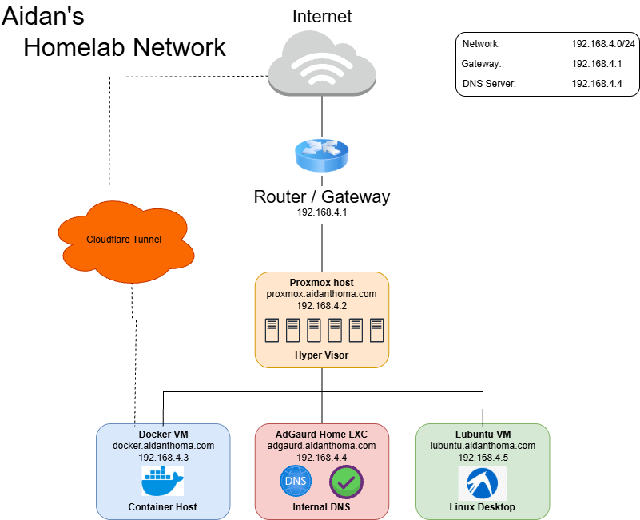

# Aidan's Homelab

Documentation for my Proxmox-based homelab used to learn virtualization, Linux administration, Docker, DNS, monitoring, networking, secure remote access, and "self-hosted" AI.

## Current Architecture



## Hosts

| Host | Type | IP | Purpose |
|---|---|---:|---|
| Proxmox | Hypervisor | `192.168.4.2` | Runs VMs and LXCs |
| Docker | VM | `192.168.4.3` | Docker workloads and "self-hosted" services |
| DNS | Debian LXC | `192.168.4.4` | AdGuard Home internal DNS |
| Lubuntu | VM | `192.168.4.5` | Linux desktop / lab VM |

## Internal DNS

AdGuard Home provides DNS for selected homelab systems only. The household router DNS is intentionally unchanged.

Current internal records:

```text
proxmox.aidanthoma.com -> 192.168.4.2
docker.aidanthoma.com  -> 192.168.4.3
adguard.aidanthoma.com -> 192.168.4.4
lubuntu.aidanthoma.com -> 192.168.4.5
```

## Services

- Proxmox VE
- Docker (Containers)
- OpenWebUI (AI)
- Cloudflare Tunnel
- Prometheus (Fetch PVE Logs)
- cAdvisor (Fetch Docker Container Logs)
- Proxmox exporter
- AdGuard Home (DNS)
- SSH

## Documentation

- [Network](network.md)
- [Services](services.md)
- [DNS](dns.md)
- [Monitoring](monitoring.md)
- [Cloudflare](cloudflare.md)
- [Backups](backups.md)
- [Security](SECURITY.md)
- [Runbooks](runbooks/)


## Planned Improvements

- Grafana dashboard for Docker container
- Proxmox Backup Server
- Tailscale or WireGuard as a VPN